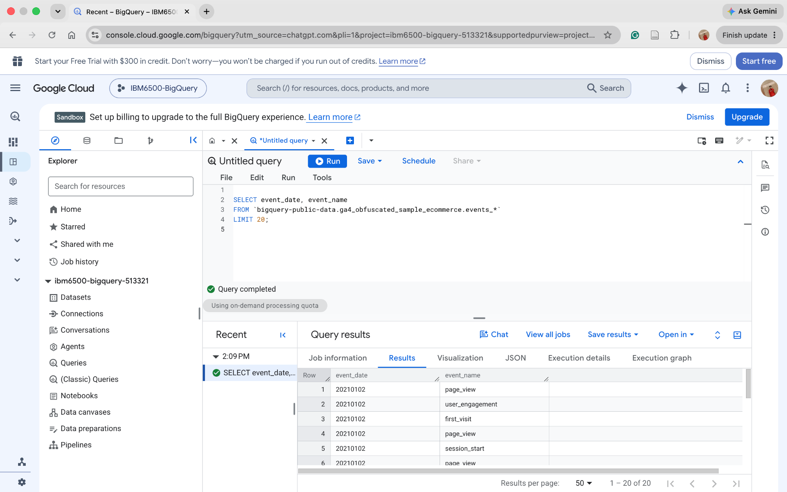
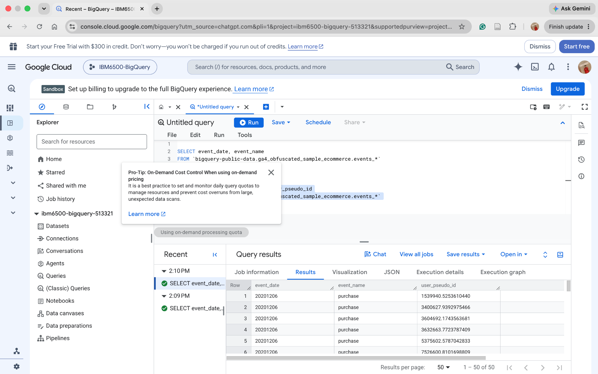
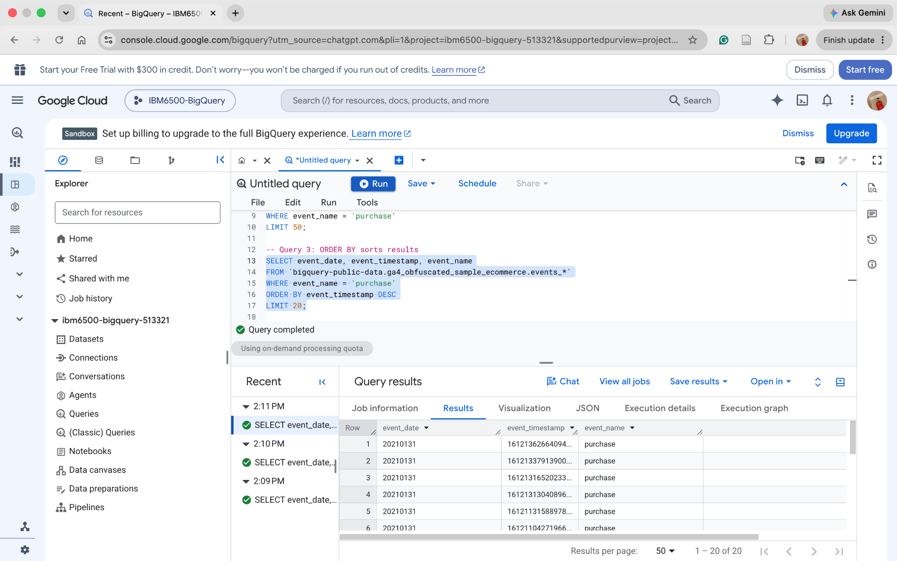
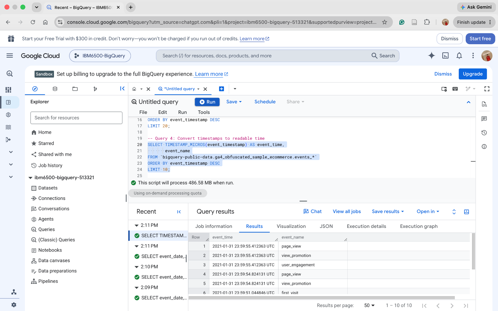
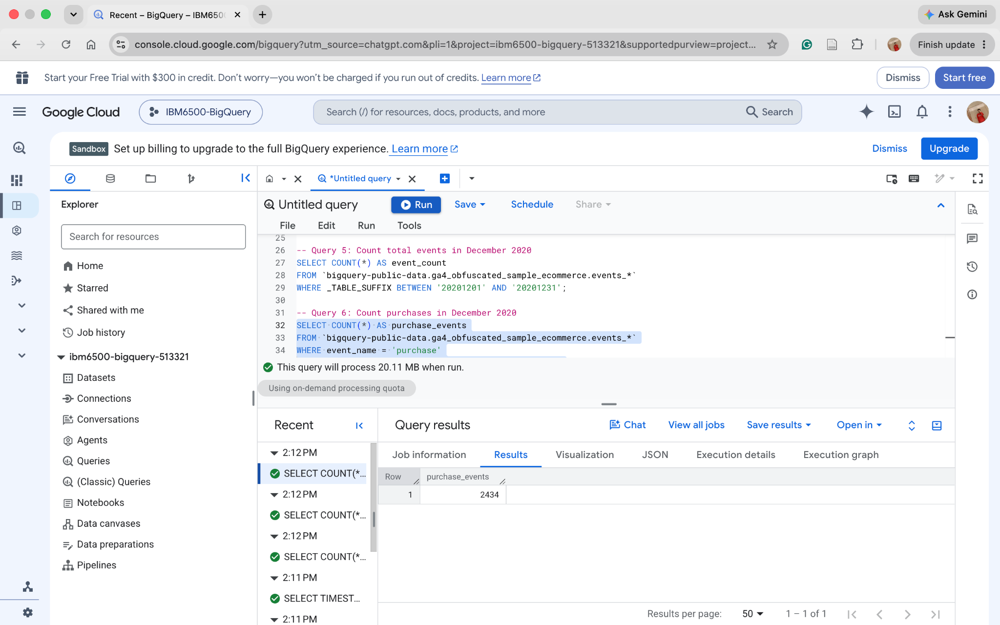
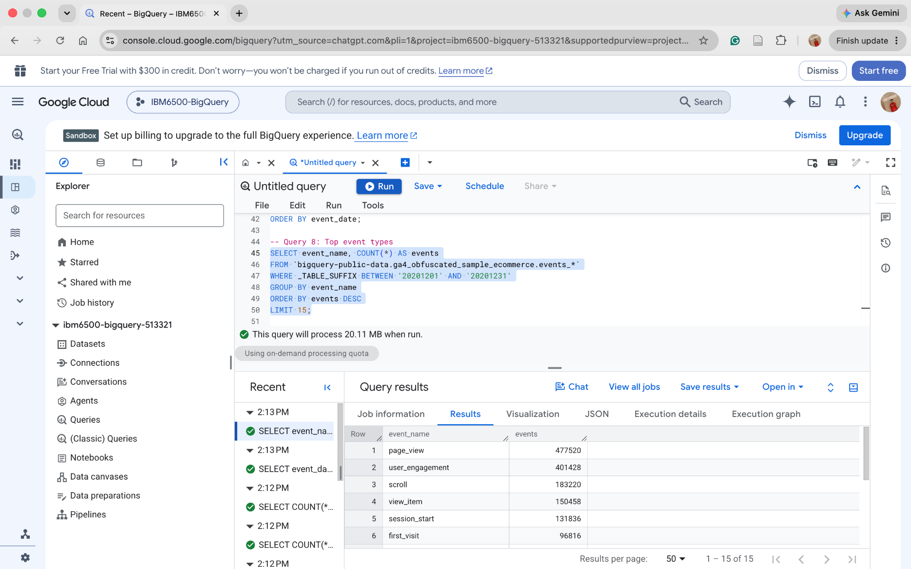
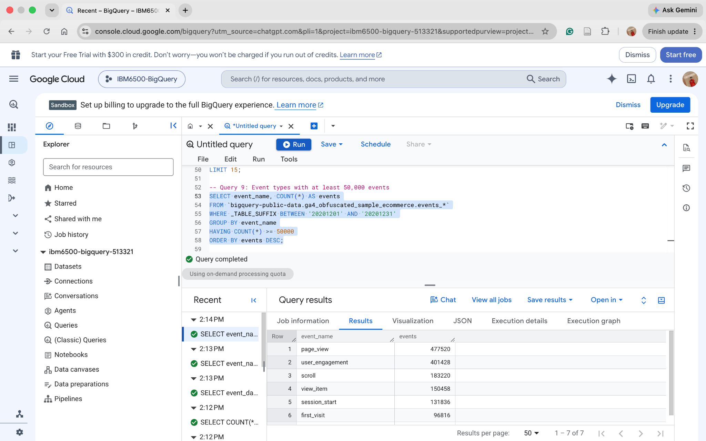
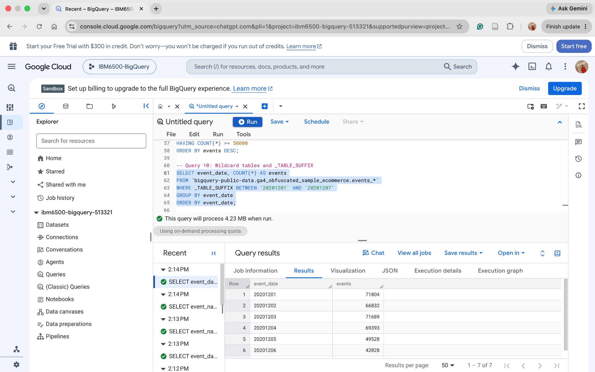

## Query 1: Select Basic Event Data

This query retrieves 20 records from the GA4 sample dataset to explore event dates and event names.

``` sql
SELECT event_date, event_name
FROM `bigquery-public-data.ga4_obfuscated_sample_ecommerce.events_*`
LIMIT 20;
```

### Query 1 Result



## Query 2: Filter Purchase Events

This query uses WHERE to display only purchase events and their associated user IDs.

``` sql
SELECT event_date, event_name, user_pseudo_id
FROM `bigquery-public-data.ga4_obfuscated_sample_ecommerce.events_*`
WHERE event_name = 'purchase'
LIMIT 50;
```

### Query 2 Result



## Query 3: Sort Purchase Events

This query sorts purchase events by timestamp, showing the most recent purchases first.

``` sql
SELECT event_date, event_timestamp, event_name
FROM `bigquery-public-data.ga4_obfuscated_sample_ecommerce.events_*`
WHERE event_name = 'purchase'
ORDER BY event_timestamp DESC
LIMIT 20;
```

### Query 3 Result



## Query 4: Convert Timestamps

This query converts event timestamps into readable dates and times.

``` sql
SELECT TIMESTAMP_MICROS(event_timestamp) AS event_time,
       event_name
FROM `bigquery-public-data.ga4_obfuscated_sample_ecommerce.events_*`
ORDER BY event_timestamp DESC
LIMIT 10;
```

### Query 4 Result



## Query 5: Count Total Events

This query counts all events recorded in December 2020.

``` sql
SELECT COUNT(*) AS event_count
FROM `bigquery-public-data.ga4_obfuscated_sample_ecommerce.events_*`
WHERE _TABLE_SUFFIX BETWEEN '20201201' AND '20201231';
```

### Query 5 Result

\![(images/query5.png)

**Result:** 1,612,725 events.

## Query 6: Count Purchase Events

This query counts the total number of purchase events in December 2020.

``` sql
SELECT COUNT(*) AS purchase_events
FROM `bigquery-public-data.ga4_obfuscated_sample_ecommerce.events_*`
WHERE event_name = 'purchase'
  AND _TABLE_SUFFIX BETWEEN '20201201' AND '20201231';
```

### Query 6 Result



**Result:** 2,434 purchase events.

## Query 7: Count Events by Day

This query uses GROUP BY to count the number of events for each day in December 2020.

``` sql
SELECT event_date, COUNT(*) AS events
FROM `bigquery-public-data.ga4_obfuscated_sample_ecommerce.events_*`
WHERE _TABLE_SUFFIX BETWEEN '20201201' AND '20201231'
GROUP BY event_date
ORDER BY event_date;
```

### Query 7 Result


## Query 8: Most Common Event Types

This query identifies the 15 most frequent event types in December 2020.

``` sql
SELECT event_name, COUNT(*) AS events
FROM `bigquery-public-data.ga4_obfuscated_sample_ecommerce.events_*`
WHERE _TABLE_SUFFIX BETWEEN '20201201' AND '20201231'
GROUP BY event_name
ORDER BY events DESC
LIMIT 15;
```

### Query 8 Result



## Query 9: Events with at Least 50,000 Records

This query uses HAVING to identify event types that occurred at least 50,000 times.

``` sql
SELECT event_name, COUNT(*) AS events
FROM `bigquery-public-data.ga4_obfuscated_sample_ecommerce.events_*`
WHERE _TABLE_SUFFIX BETWEEN '20201201' AND '20201231'
GROUP BY event_name
HAVING COUNT(*) >= 50000
ORDER BY events DESC;
```

### Query 9 Result



## Query 10: Wildcard Tables and Date Filtering

This query uses wildcard tables and \_TABLE_SUFFIX to analyze daily event counts during the first week of December 2020.

``` sql
SELECT event_date, COUNT(*) AS events
FROM `bigquery-public-data.ga4_obfuscated_sample_ecommerce.events_*`
WHERE _TABLE_SUFFIX BETWEEN '20201201' AND '20201207'
GROUP BY event_date
ORDER BY event_date;
```

### Query 10 Result



## GitHub Links

-   [GitHub Repository](https://github.com/WillySuu/W04-BigQuery-SQL-Lecture1)
-   [GitHub Pages](https://willysuu.github.io/W04-BigQuery-SQL-Lecture1/)
